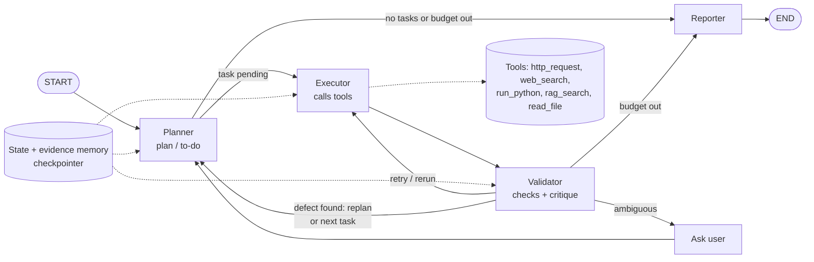

# Autonomous API Testing & Contract Validator

An agent that takes an OpenAPI file and a base URL, tests every endpoint, finds places where the API breaks its own contract, and writes a short report in which every finding cites the evidence behind it.

It is a LangGraph `StateGraph` (no `create_react_agent`, no message list): a planner keeps a to-do list of tests, an executor calls tools, a validator checks every result and decides what to do next, and a reporter writes the report. It runs from the terminal or as a FastAPI service.

## 1. Overview and architecture



The diagram source is `docs/architecture.mmd`; `docs/architecture.png` is exported from it with mermaid-cli (see section 2).

| Folder | What is in it |
|---|---|
| `app/` | the agent: `graph.py` (wiring and routers), `nodes/`, `tools/`, `spec.py` (OpenAPI to tasks), `checks.py`, `redact.py`, `llm.py`, `prompts.py`, `cli.py`, `main.py` (FastAPI) |
| `target_api/` | a small FastAPI app with switchable bugs and faults, and its `openapi.yaml` |
| `eval/` | `scenarios.yaml`, `run_eval.py` and the generated `report.md` |
| `workspace/` | docs the `read_file` and `rag_search` tools may read |
| `tests/` | pytest suite (`pytest -q`) |

## 2. Setup

Python 3.14 (all dependencies import cleanly on 3.14.6).

```bash
python3.14 -m venv .venv && source .venv/bin/activate
pip install -r requirements.txt          # exact versions in requirements.lock.txt
cp .env.example .env                     # set GEMINI_API_KEY and AGENT_MODEL for the real model
```

The Gemini free tier allows about 20 requests per day per model; a full `python -m eval.run_eval` uses about 20 (two per run). When a model call fails (quota, overload), the run continues on safe defaults and the eval report counts the failures. Without `AGENT_MODEL` the agent uses a scripted fake LLM, so everything below also runs without an API key. `TAVILY_API_KEY` is optional: without it `web_search` falls back to `rag_search`.

```bash
# 1. the API under test (bugs and faults are optional)
SEEDED_BUGS=BUG_RADIUS_MIN FAULTS=FAULT_503_THEN_OK uvicorn target_api.main:app --port 9000

# 2. the agent, from the terminal
python -m app.cli --spec target_api/openapi.yaml --base-url http://localhost:9000

# 3. or the agent as a service
uvicorn app.main:app

# tests, evaluation, diagram
pytest -q
python -m eval.run_eval                  # writes eval/report.md
npx -y @mermaid-js/mermaid-cli -i docs/architecture.mmd -o docs/architecture.png -b white
```

Seeded bugs (`SEEDED_BUGS=ID,ID`): `BUG_RADIUS_MIN` (accepts `radius <= 0`), `BUG_DISTANCE_STRING` (`distance` is a string), `BUG_MISSING_LNG_500` (missing `lng` gives 500), `BUG_AUTH_BYPASS` (favorites without a token). Faults (`FAULTS=ID,ID`): `FAULT_503_THEN_OK` (two 503s, then normal), `FAULT_TIMEOUT_ALWAYS` (`/v1/favorites` hangs). `POST /__admin/reset` clears fault counters.

## 3. Agent pattern

**Plan, act, validate, replan.** The planner turns the spec into a to-do list of tests (normal values, boundaries, missing, wrong type, out of range, no token), then asks the LLM to order them by risk and suggest a few extras. The executor runs one task with a tool. The validator checks the raw result with deterministic rules and picks the next move: go on, retry a broken request, rerun to confirm a defect, replan around a confirmed defect, or ask the user. The loop ends when the to-do list is empty or a budget runs out.

Why it is agentic and not a script: the path through the graph depends on what the API does. A defect triggers a rerun, a reproduced defect triggers a replan that adds new tests around it, a transient failure is retried with backoff, a failing tool is swapped for its fallback, and an undocumented case pauses the run to ask a human. Every move is a conditional edge decided from state, and every decision is written to `decision_log` with a reason.

The LLM is used in exactly four places (ordering the plan, repairing a request on retry, classifying a result no rule fits, writing the summary). It cannot confirm a finding on its own: confirmation needs two independent calls that show the same violation of a documented expectation.

## 4. State

`AgentState` (`app/state.py`) is a `TypedDict` of plain JSON-friendly values, checkpointed by `InMemorySaver`. Fields marked *append* use an `operator.add` reducer.

| Field | Written by | Meaning |
|---|---|---|
| `run_id`, `base_url`, `config`, `started_at`, `spec_text` | start of run | inputs and `RunConfig` |
| `endpoints` | planner | operations parsed from the OpenAPI file |
| `tasks` | planner (add, order, cancel), executor (attempts, repaired request), validator (status, outcome) | the to-do list |
| `current_task_id`, `tool_name`, `tool_args` | planner, executor | the task being worked on and how |
| `last_result` | executor | outcome of the last tool call and its evidence id |
| `evidence` *append* | executor | redacted request and response, `e_001`, `e_002`, ... |
| `critiques` *append* | validator | issue, feedback, action and the checks for each result |
| `findings` *append* | validator | defects with class, status (`confirmed`/`suspected`) and evidence ids |
| `decision_log` *append* | every node | `{step, node, decision, reason}` |
| `clarifications` *append*, `pending_question` | ask_user, validator | human-in-the-loop questions and answers |
| `action` | validator, planner | the validator's verdict: `next`, `retry`, `rerun`, `replan`, `ask_user` |
| `retries`, `tool_failures` | executor | retries per `task:tool`, consecutive failures per tool |
| `steps`, `tool_calls`, `replans` | executor, planner | budget counters |
| `status`, `stop_reason`, `report_path`, `report_md` | reporter, validator, ask_user | final state and the report |

Run-time dependencies (the LLM, HTTP transports, API keys) are passed through LangGraph's `context` (`app.config.Deps`), so they are never checkpointed and tests can swap them.

## 5. Workflow

Routers (`app/graph.py`) are pure functions of state; the first matching rule wins and rule 1 is always the budget guard.

| After | # | Condition | Next |
|---|---|---|---|
| planner | 1 | budget exhausted | reporter |
| planner | 2 | no task is pending | reporter |
| planner | 3 | otherwise | executor |
| executor | 1 | budget exhausted | reporter |
| executor | 2 | otherwise | validator |
| validator | 1 | budget exhausted | reporter |
| validator | 2 | `action` is `retry` or `rerun` | executor |
| validator | 3 | `action == "ask_user"` | ask_user |
| validator | 4 | `action == "replan"` and `replans < max_replans` | planner |
| validator | 5 | otherwise (`next`) | planner |

`ask_user` always returns to the planner, and the reporter goes to `END`.

How the validator classifies a result (rules first, LLM only when none fits):

| Situation | Issue | Action |
|---|---|---|
| all checks pass | `ok` | `next` |
| a documented expectation is violated | `api_defect` | `rerun` the first time, `replan` once reproduced |
| a 400 that blames a different parameter than the one under test | `test_error` | `retry` with an LLM-repaired request |
| timeout, connection error, 502/503/504 after retries | `infra_failure` | `next`, task `inconclusive` |
| no documented response for the case | `ambiguous` | `ask_user` (interactive) or `next` |

## 6. Tools

| Category | Tool | Limits | Fallback |
|---|---|---|---|
| Function calling | `http_request` | base URL allowlist, `POST/PUT/PATCH/DELETE` need `allow_mutating`, 25 calls per endpoint per run, request timeout, token inserted only at send time | none: the task becomes inconclusive |
| Search | `web_search` | Tavily over `httpx`, top 5 results | `rag_search` |
| Code and compute | `run_python` | `python -I` subprocess, empty env, temp dir, no shell, 5 s timeout, 4 KB output | none |
| RAG | `rag_search` | keyword overlap over spec chunks and workspace docs, top 3; no match counts as a failure | `web_search` |
| System | `read_file` | inside `WORKSPACE_DIR` only, path traversal rejected, 4 KB | `rag_search` |

The planner uses `web_search` to look up docs when the spec leaves a case undocumented, and the question to the user quotes what it found. A tool with 5 failures in a row is no longer chosen. Before anything is stored, `redact.py` masks `Authorization`, `Cookie`, `X-API-Key`, fields named like `password`/`token`/`secret`, JWTs and bearer credentials. API responses are passed to the LLM between untrusted-data delimiters, with an instruction never to follow them.

## 7. Stopping rules, retries and fallbacks

- **Complete:** the to-do list is empty. **Partial:** a budget ran out (`max_steps` 50, `max_tool_calls` 60, `max_seconds` 300); the report starts with the stop reason and lists what was not run.
- **Transient failures** (timeout, 502, 503, 504) are retried inside the executor with backoff `min(0.5 * 2**n, 4)` s, up to `max_retries_per_tool` (2).
- **Per task:** at most 2 validator-driven retries per `task:tool` and 3 attempts in total; after that the task is inconclusive.
- **Replans:** at most `max_replans` (3).
- **Backstop:** `recursion_limit = max_steps * 3 + 20`. The budget guard always fires first, so `GraphRecursionError` never happens (tested).
- **Order of recovery:** retry with a repaired request, switch to the fallback tool, replan, ask the user (or mark inconclusive), and finally write a partial report with what was verified.

## 8. Human in the loop

When the spec does not document what a case should return, an interactive run pauses with LangGraph `interrupt()` and the question is exposed by the service. Resuming with `Command(resume=answer)` continues from the checkpoint; status codes in the answer become the expectation and the test is re-run. Any other answer (for example `skip`) marks it inconclusive.

```bash
uvicorn app.main:app &      # the service, on :8000

# start a run (spec is the OpenAPI text); here the 401 for /v1/favorites is undocumented
curl -s -X POST localhost:8000/runs -H 'content-type: application/json' \
  -d "$(python -c 'import json; print(json.dumps({"spec": open("target_api/openapi_undocumented.yaml").read(), "base_url": "http://localhost:9000"}))')"
# {"run_id":"run_9a9ebc3d","status":"running"}

curl -s localhost:8000/runs/run_9a9ebc3d
# {"status":"awaiting_input","pending_question":"t_023 GET /v1/favorites: request without a bearer token. The spec
#  documents no response for this case. Docs found [e_001]: \"The favorites endpoint needs a bearer token. A missing
#  or wrong token returns HTTP 401.\". Which status code(s) should it return? ...", "steps":27, ...}

curl -s -X POST localhost:8000/runs/run_9a9ebc3d/resume -H 'content-type: application/json' -d '{"answer": "401"}'
# {"run_id":"run_9a9ebc3d","status":"running"}

curl -s localhost:8000/runs/run_9a9ebc3d            # "status":"complete"
curl -s localhost:8000/runs/run_9a9ebc3d/trace      # decision log
curl -s localhost:8000/runs/run_9a9ebc3d/report     # markdown report
```

Endpoints: `POST /runs`, `GET /runs/{id}`, `GET /runs/{id}/trace`, `POST /runs/{id}/resume`, `GET /runs/{id}/report`, `GET /health`. Pass `"config": {"interactive": false}` to never pause.

## 9. Real execution trace

From `decision_log` of a real CLI run with the real model (`gemini-3.5-flash`) against `target_api` started with `SEEDED_BUGS=BUG_RADIUS_MIN FAULTS=FAULT_503_THEN_OK` (`python -m app.cli --spec target_api/openapi.yaml --base-url http://localhost:9000 --non-interactive`). Passing checks and routine task picks are left out.

```
step 01 planner   plan                   25 tasks for 2 endpoints. Authentication checks and invalid input validation edge cases are prioritized first to ensure security and boundary enforcement before executing happy path tests.
step 03 executor  call_http_request      GET /v1/favorites -> 503 -> retry 1/2 -> 503 -> retry 2/2 -> 401 (e_001)
step 04 validator ok:next                all checks passed
...
step 36 executor  call_http_request      GET /v1/restaurants/nearby?lat=9.03&lng=38.75&radius=0 -> 200 (e_012)
step 37 validator api_defect:rerun       status_code: expected [400], got 200; range: out-of-range input got HTTP 200. Rerun to confirm
step 38 executor  rerun_http_request     GET /v1/restaurants/nearby?lat=9.03&lng=38.75&radius=0 -> 200 (e_013)
step 39 validator api_defect:replan      defect reproduced twice, replan around it. status_code: expected [400], got 200; range: out-of-range input got HTTP 200
step 40 planner   replan                 added 2 neighbor tasks around confirmed defects (t_026, t_027)
step 42 executor  call_http_request      GET /v1/restaurants/nearby?lat=9.03&lng=38.75&radius=-1 -> 200 (e_014)
step 43 validator api_defect:next        same defect class as a known finding. status_code: expected [400], got 200; range: out-of-range input got HTTP 200
step 45 executor  call_http_request      GET /v1/restaurants/nearby?lat=9.03&lng=38.75&radius=-100 -> 200 (e_015)
step 46 validator api_defect:next        same defect class as a known finding. status_code: expected [400], got 200; range: out-of-range input got HTTP 200
...
step 81 executor  call_http_request      GET /v1/restaurants/nearby?lat=9.03&lng=38.75&radius=10.5 -> 400 (e_027)
...
step 84 executor  blocked                25 calls already made to GET /v1/restaurants/nearby this run
step 85 validator blocked:next           call blocked by the safety gate: blocked: 25 calls already made to GET /v1/restaurants/nearby this run
step 86 planner   no_tasks_left          every task is done, handing over to the reporter
step 87 reporter  COMPLETE               F1 confirmed (e_012, e_013, e_014, e_015)
```

Failure (two 503s on the first call), recovery (backoff retry, then the real answer), critique (the validator flags `radius=0` and reruns it), replan (neighbor values `-1` and `-100`, both also accepted), and a confirmed finding citing four evidence ids. The model ordered auth and validation tests first, which is why `/v1/favorites` was the first call, and it added an extra `radius=10.5` test. The last task was stopped by the 25-calls-per-endpoint cap and reported inconclusive. The report's summary, written by the model and checked for unknown ids, reads:

> We found finding F1, where out-of-range input returned an HTTP 200 status code instead of the expected HTTP 400 [e_012] [e_013] [e_014] [e_015].

## 10. Evaluation

See [`eval/report.md`](eval/report.md): 9 scenarios (no bugs, each bug alone, all four, a bug under 503 faults, timeouts, an undocumented endpoint), with detection rate, false positives, recovery under faults, citation validity, steps and tool calls, and a trace line for each agentic behavior. Regenerate it with `python -m eval.run_eval` (add `--fake-llm` to run without an API key).
