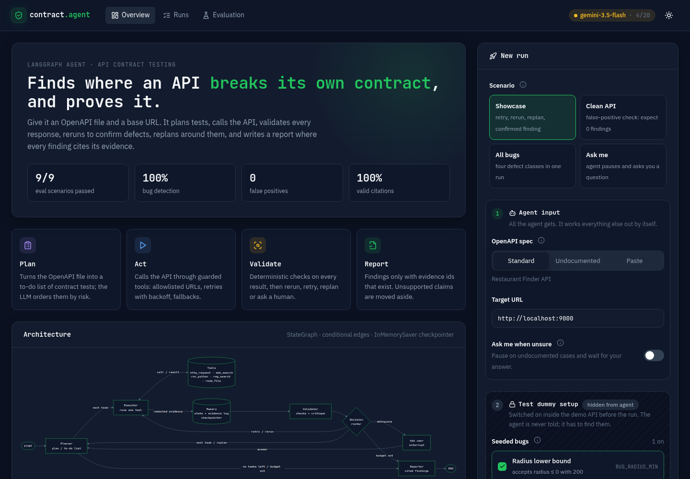
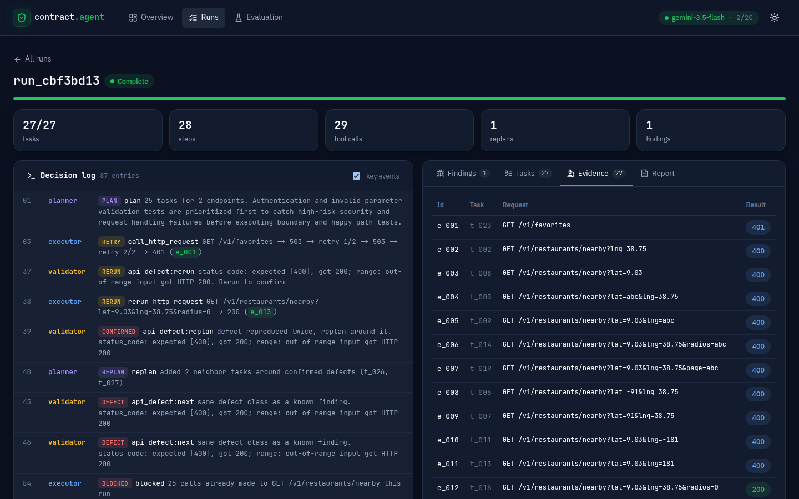
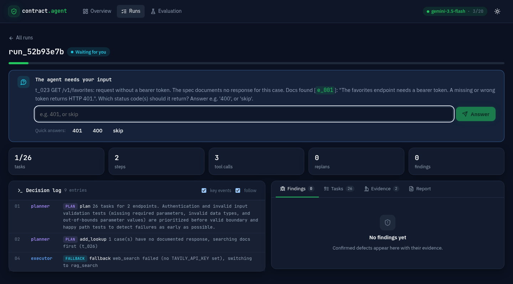
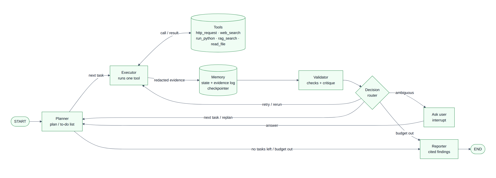
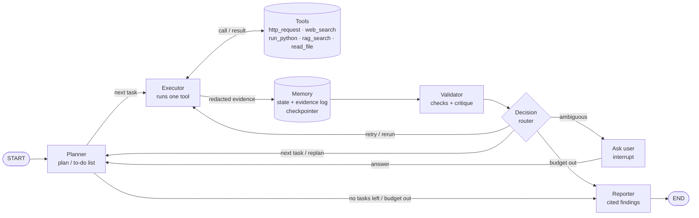

<div align="center">

# 🛡️ Autonomous API Testing & Contract Validator

**An AI agent that finds where an API breaks its own contract, and proves it.**

Give it an OpenAPI file and a URL. It plans the tests, calls the API through guarded tools, validates every response,
reruns failures to confirm them, replans around defects, asks you when the spec is silent, and writes a report in which
every finding cites its evidence.




</div>

---

## ✨ At a glance

| Requirement | How this project meets it | Where |
|---|---|---|
| Practical domain, clear goal | API contract testing: find contract violations, backed by evidence | [Overview](#-how-it-works) |
| LangGraph with branches, loops and state | 5 nodes; every move out of planner, executor and validator is a conditional edge; retry, replan and ask-user loops; checkpointed `AgentState` | `app/graph.py`, `app/state.py` |
| 5 tools from the execution categories | `http_request` · `web_search` · `run_python` · `rag_search` · `read_file`, all used in a normal run | [Tools](#-tools) |
| Meta-tools | plan/to-do (planner) · critique (validator) · ask user (`interrupt`) · tool selection (fallbacks) | [Agent pattern](#-agent-pattern) |
| Task state, validated outputs, citations, explained decisions | `Task` status and outcome · 7 deterministic checks on every response · evidence ids plus a citation check · `decision_log` with a reason for every step | [State](#-state), [Workflow](#-workflow) |
| Runnable code and setup | one-command demo, CLI, REST service, 53 tests | [Quick start](#-quick-start) |
| Architecture diagram | planner → tools → memory → validation → decision | [`docs/architecture.png`](docs/architecture.png) |
| One-page evaluation | 9 scenarios, success rate, failures, limitations, improvements, agentic behavior | [`eval/report.md`](eval/report.md) |

---

## 🚀 Quick start

**You need:** Python 3.14, Node 18+ (only for the web demo) and, optionally, a free [Gemini API key](https://aistudio.google.com/apikey).

```bash
git clone https://github.com/Enoch-Tadesse/Autonomous-API-Testing-Contract-Validatior.git
cd Autonomous-API-Testing-Contract-Validatior

python3.14 -m venv .venv
.venv/bin/pip install -r requirements.txt

cp .env.example .env        # then set GEMINI_API_KEY and AGENT_MODEL=google_genai:gemini-3.5-flash
                            # (leave them empty to use the built-in fake LLM, with no key needed)

scripts/demo.sh             # builds the web UI on first run, starts everything
```

Open **http://localhost:8000**. Ctrl+C stops both servers.

> 💡 **No API key?** Leave `AGENT_MODEL` empty. The agent runs on a scripted fake LLM and still finds every bug, because findings come from deterministic checks, not from the model.

### 🔎 Check it out in 5 minutes

| # | Do this | What you should see |
|---|---|---|
| 1 | Open the **Overview** page | evaluation numbers, the four steps of the agent, the live architecture diagram |
| 2 | Click **Showcase**, then **Launch run** | the decision log fills live: `DOCS` → `PLAN` → `COMPUTE` → `RETRY` (503) → `RERUN` → `CONFIRMED` → `REPLAN` → `DEFECT` → `COMPLETE` |
| 3 | Open the **Findings** tab | **F1 confirmed**: `radius=0` accepted with 200; click an evidence id like `e_012` to see the real request and response |
| 4 | Open the **Report** tab | the final markdown report; every `[e_…]` citation is clickable |
| 5 | Click **Clean API**, then **Launch run** | **0 findings**: the false-positive check |
| 6 | Click **Ask me**, then **Launch run** | the run pauses and asks what an undocumented case should return; click **401** and it finishes |
| 7 | Click **All bugs**, then **Launch run** | five findings: validation, schema, server error, auth, pagination |
| 8 | Open the **Evaluation** page | the 9-scenario report |

<p align="center">
  
  
</p>

> **The agent only ever gets the spec and the URL** (box 1 in the New run panel). Seeded bugs and faults (box 2) are switched on *inside the demo API* before the run; the agent is never told and has to find them. On a real API there is no box 2.

---

## 🧠 How it works



<details>
<summary>Mermaid source (renders on GitHub)</summary>



</details>

**One run, step by step:**

1. **Read and plan.** The planner parses the OpenAPI file into test tasks (normal values, boundaries, missing, wrong type, out of range, no token). It reads the project notes with `read_file`, then makes **one LLM call** to order the tasks by risk and propose extra tests. It also adds doc lookups for undocumented cases and a pagination check.
2. **Act.** The executor runs one task through a tool, behind a safety gate (allowlisted host, no mutating calls, call cap). It retries transient errors with backoff and switches to a fallback tool when one fails. The result is redacted and stored as evidence `e_001`, `e_002`, …
3. **Validate.** The validator runs 7 deterministic checks on every response (status, JSON, content type, schema, range, …) and decides what happens next.
4. **Decide.** All checks pass → next task. A defect → **rerun** to confirm. Same failure twice → **confirmed**, then **replan** with neighbor values. Our own request was broken → **retry** with an LLM-repaired request. The spec is silent → **ask the user**. A budget ran out → report.
5. **Report.** Findings are merged, citation-checked and summarized, and the report is written to `data/reports/<run_id>.md`.

---

## 🤖 Agent pattern

**Plan → act → validate → decide (retry · rerun · replan · ask), in a loop until the to-do list is empty or a budget runs out.**

It's agentic, not a script, because the path depends on what the API does:
- a 503 is retried;
- a defect is rerun to confirm it, and a confirmed defect makes the planner add new tests around it;
- a failing tool is swapped for its fallback;
- an undocumented case pauses the run for a human.

Every move is a conditional edge decided from state, and every decision is logged with a reason.

| Meta-tool | Implementation |
|---|---|
| **Plan / to-do** | `app/nodes/planner.py`: the only node that adds, orders or cancels tasks; the task list in state *is* the to-do list |
| **Critique** | `app/nodes/validator.py`: a critique for every result; rules first, an LLM `Critique` only when no rule fits |
| **Ask user** | `app/nodes/ask_user.py`: LangGraph `interrupt()`; resume with `Command(resume=answer)` |
| **Tool selection** | `app/nodes/executor.py` and `app/tools/__init__.py`: switch to the `FALLBACKS` tool; stop choosing a tool after 5 failures in a row |

**The LLM is an advisor, not a judge.** It's used in exactly four places: ordering the plan, repairing a broken request, classifying a result no rule fits, and writing the summary. It can never confirm a finding on its own, and if it's unavailable (quota, outage) every call falls back to a safe default and the run still completes.

---

## 🧰 Tools

All five tools are used by the agent in a normal run, not only in tests.

| Category | Tool | When the agent uses it | Safety limits | Fallback |
|---|---|---|---|---|
| Function calling | `http_request` | every contract test, plus the two pagination pages | base-URL allowlist · `POST/PUT/PATCH/DELETE` need `allow_mutating` · 25 calls per endpoint · timeout · real token inserted only at send time | none: the task becomes inconclusive |
| System and environment | `read_file` | first step: reads the project notes in `workspace/` as context for the plan | inside `WORKSPACE_DIR` only · path traversal rejected · 4 KB | `rag_search` |
| Code and compute | `run_python` | pagination check: a generated script compares page 1 and page 2 (no duplicates, within `total`, order kept) | `python -I` · empty env · temp dir · no shell · 5 s timeout · 4 KB output | none |
| Search | `web_search` | the spec leaves a case undocumented: look it up before asking | Tavily over `httpx` · top 5 | `rag_search` |
| RAG | `rag_search` | fallback for search and docs: keyword retrieval over spec chunks and notes | top 3 · no match counts as a failure | `web_search` |

Every tool output is validated: HTTP responses by the deterministic checks, the `run_python` result by parsing and judging its JSON, and the other tools for a usable result. `app/redact.py` masks `Authorization`, `Cookie`, `X-API-Key`, password/token/secret fields, JWTs and bearer credentials before anything is stored. API responses reach the LLM only between untrusted-data delimiters.

---

## 🗂️ State

`AgentState` (`app/state.py`) is a `TypedDict` of plain JSON values, checkpointed with `InMemorySaver`. *Append* fields use an `operator.add` reducer.

| Field | Written by | Meaning |
|---|---|---|
| `run_id`, `base_url`, `config`, `started_at`, `spec_text` | start of run | the inputs: spec, URL and `RunConfig` |
| `endpoints`, `planned` | planner | parsed operations; whether the planning call has run |
| `tasks` | planner, executor, validator | the to-do list: each `Task` has `status`, `outcome`, `attempts`, `parent_id`, `depends_on` |
| `current_task_id`, `tool_name`, `tool_args` | planner, executor | what is running now, and with which tool |
| `last_result` | executor | outcome of the last tool call and its evidence id |
| `evidence` *append* | executor | redacted request and response per call: `e_001`, `e_002`, … |
| `critiques` *append* | validator | issue, feedback, action and checks for every result |
| `findings` *append* | validator | defects with class, `confirmed`/`suspected` status and evidence ids |
| `decision_log` *append* | every node | `{step, node, decision, reason}` |
| `clarifications` *append*, `pending_question` | ask_user, validator | human-in-the-loop questions and answers |
| `action` | validator, planner | verdict: `next`, `retry`, `rerun`, `replan`, `ask_user` |
| `retries`, `tool_failures`, `steps`, `tool_calls`, `replans` | executor, planner | retry and budget counters |
| `status`, `stop_reason`, `report_path`, `report_md` | reporter | final status and the report |

Run-time dependencies (LLM, HTTP transports, keys) are passed through LangGraph's `context` (`app.config.Deps`), so they're never checkpointed and tests can swap them.

---

## 🔀 Workflow

Routers in `app/graph.py` are pure functions of state, unit-tested row by row. The first matching rule wins, and **rule 1 is always the budget guard**.

| After | # | Condition | Next |
|---|---|---|---|
| planner | 1 | budget exhausted | reporter |
| planner | 2 | no task left | reporter |
| planner | 3 | otherwise | executor |
| executor | 1 | budget exhausted | reporter |
| executor | 2 | otherwise | validator |
| validator | 1 | budget exhausted | reporter |
| validator | 2 | `action` is `retry` or `rerun` | executor |
| validator | 3 | `action == "ask_user"` | ask_user |
| validator | 4 | `action == "replan"` and `replans < max_replans` | planner |
| validator | 5 | otherwise (`next`) | planner |

`ask_user` always returns to the planner; the reporter goes to `END`.

How the validator classifies a result:

| Situation | Issue | Action |
|---|---|---|
| all checks pass | `ok` | `next` |
| a documented expectation is violated | `api_defect` | `rerun` the first time, `replan` once reproduced |
| a 400 that blames a different parameter than the one under test | `test_error` | `retry` with an LLM-repaired request |
| timeout, connection error, 502/503/504 after retries | `infra_failure` | `next`, task `inconclusive` |
| no documented response for the case | `ambiguous` | `ask_user` (interactive) or `next` |
| none of the above | LLM critique | at most a *suspected* finding |

---

## 🛑 Stopping rules, retries and fallbacks

| | Rule |
|---|---|
| **Complete** | the to-do list is empty |
| **Partial** | a budget ran out (`max_steps` 50, `max_tool_calls` 60, `max_seconds` 300); the report starts with the stop reason |
| **Transient retries** | timeout, 502, 503 and 504 are retried with backoff `min(0.5·2ⁿ, 4)` s, up to 2 times |
| **Per task** | at most 2 validator-driven retries per `task:tool` and 3 attempts in total, then inconclusive |
| **Confirmation** | a defect is rerun; same failure twice → confirmed, otherwise suspected |
| **Replans** | at most 3 |
| **Fallbacks** | `web_search ↔ rag_search`, `read_file → rag_search`; a tool with 5 failures in a row is skipped |
| **LLM failure** | any model error (quota, overload) → safe default; findings are unaffected |
| **Backstop** | `recursion_limit = max_steps·3 + 20`; the budget guard always fires first (tested) |

Order of recovery: **retry → fallback tool → replan → ask the user (or mark inconclusive) → partial report** with what was verified.

---

## 🙋 Human in the loop

When the spec doesn't document what a case should return, an interactive run pauses with `interrupt()`. In the web demo a question card appears, quoting what the docs lookup found. Through the REST API:

```bash
# start a run: the spec is the OpenAPI text, and here the 401 for /v1/favorites is undocumented
curl -s -X POST localhost:8000/runs -H 'content-type: application/json' \
  -d "$(python3 -c 'import json; print(json.dumps({"spec": open("target_api/openapi_undocumented.yaml").read(), "base_url": "http://localhost:9000"}))')"
# {"run_id":"run_9a9ebc3d","status":"running"}

curl -s localhost:8000/runs/run_9a9ebc3d
# {"status":"awaiting_input","pending_question":"t_023 GET /v1/favorites: request without a bearer token. The spec
#  documents no response for this case. Docs found [e_001]: \"... A missing or wrong token returns HTTP 401.\" ..."}

curl -s -X POST localhost:8000/runs/run_9a9ebc3d/resume -H 'content-type: application/json' -d '{"answer": "401"}'
curl -s localhost:8000/runs/run_9a9ebc3d/report    # once "status" is "complete"
```

Status codes in the answer become the expectation and the test is re-run; `skip` marks it inconclusive.

---

## 📜 Real execution trace

From the `decision_log` of a real run with **gemini-3.5-flash** against the demo API with `BUG_RADIUS_MIN` and `FAULT_503_THEN_OK` (routine steps left out):

```
step 01 planner   plan                   25 tasks for 2 endpoints. Authentication checks and invalid input validation edge cases are prioritized first to ensure security and boundary enforcement before executing happy path tests.
step 03 executor  call_http_request      GET /v1/favorites -> 503 -> retry 1/2 -> 503 -> retry 2/2 -> 401 (e_001)
step 04 validator ok:next                all checks passed
...
step 36 executor  call_http_request      GET /v1/restaurants/nearby?lat=9.03&lng=38.75&radius=0 -> 200 (e_012)
step 37 validator api_defect:rerun       status_code: expected [400], got 200; range: out-of-range input got HTTP 200. Rerun to confirm
step 38 executor  rerun_http_request     GET /v1/restaurants/nearby?lat=9.03&lng=38.75&radius=0 -> 200 (e_013)
step 39 validator api_defect:replan      defect reproduced twice, replan around it. status_code: expected [400], got 200; range: out-of-range input got HTTP 200
step 40 planner   replan                 added 2 neighbor tasks around confirmed defects (t_026, t_027)
step 42 executor  call_http_request      GET /v1/restaurants/nearby?lat=9.03&lng=38.75&radius=-1 -> 200 (e_014)
step 45 executor  call_http_request      GET /v1/restaurants/nearby?lat=9.03&lng=38.75&radius=-100 -> 200 (e_015)
...
step 84 executor  blocked                25 calls already made to GET /v1/restaurants/nearby this run
step 87 reporter  COMPLETE               F1 confirmed (e_012, e_013, e_014, e_015)
```

**Failure** (two 503s) → **recovery** (backoff retry) → **critique** (`radius=0` flagged, rerun) → **replan** (`-1`, `-100`) → **confirmed finding** with four evidence ids. The model put auth and validation first, and the call cap stopped one late task. Runs recorded since then also show the new opening steps: reading the project notes (`read_file`) and the pagination check (`run_python`). The summary the model wrote, checked for unknown ids:

> We found finding F1, where out-of-range input returned an HTTP 200 status code instead of the expected HTTP 400 [e_012] [e_013] [e_014] [e_015].

---

## 📊 Evaluation

Nine scenarios, each against a fresh demo server, with **gemini-3.5-flash** ([full one-page report](eval/report.md)):

| # | Scenario | Result |
|---|---|---|
| 1 | no bugs (false-positive check) | ✅ 0 findings |
| 2 | radius lower bound | ✅ validation, confirmed |
| 3 | distance as string | ✅ schema |
| 4 | missing `lng` → 500 | ✅ server error |
| 5 | auth bypass | ✅ auth |
| 6 | all four bugs | ✅ all four found |
| 7 | radius bug + flaky 503 | ✅ found, retry shown in the trace |
| 8 | hanging endpoint | ✅ inconclusive, report still written |
| 9 | undocumented endpoint | ✅ asked the user, completed |

**100% bug detection · 0 false positives · 100% recovery under faults · 100% valid citations · ~27 steps per run.**

```bash
.venv/bin/python -m eval.run_eval              # real model (about 18 Gemini calls)
.venv/bin/python -m eval.run_eval --fake-llm   # free, about 20 seconds
```

---

## 🖥️ Other ways to run it

<details>
<summary><b>Terminal (CLI)</b>: test any API from its spec</summary>

```bash
# the demo API, with some bugs switched on
SEEDED_BUGS=BUG_RADIUS_MIN FAULTS=FAULT_503_THEN_OK .venv/bin/uvicorn target_api.main:app --port 9000

# in a second terminal
.venv/bin/python -m app.cli --spec target_api/openapi.yaml --base-url http://localhost:9000
```

Options: `--fake-llm`, `--non-interactive` (never pause), `--max-steps N`, `--max-tool-calls N`. Prints the decision log and findings, and writes `data/reports/<run_id>.md`. Point `--spec` and `--base-url` at any API you're allowed to test (GET only unless `allow_mutating` is set).
</details>

<details>
<summary><b>REST service</b>: the agent behind an API</summary>

```bash
.venv/bin/uvicorn app.main:app --port 8000
```

| Method | Path | Purpose |
|---|---|---|
| `POST` | `/runs` | start a run: `{spec, base_url, config?}` → `{run_id}` |
| `GET` | `/runs/{id}` | status, counters, pending question |
| `GET` | `/runs/{id}/trace` | decision log |
| `POST` | `/runs/{id}/resume` | answer a question: `{answer}` |
| `GET` | `/runs/{id}/report` | markdown report |
| `GET` | `/runs/{id}/details` | tasks, findings, evidence, statistics |
| `GET` | `/health` | liveness |
</details>

<details>
<summary><b>Tests</b></summary>

```bash
.venv/bin/pytest -q          # 53 tests, fake LLM, no API key, about 10 s
```

They cover every routing rule, the budget stop (no `GraphRecursionError`), the end-to-end bug hunt, all five tools in one run, pause and resume, the citation check, redaction, tool safety and the LLM fallback.
</details>

<details>
<summary><b>Web UI development</b></summary>

```bash
.venv/bin/uvicorn app.main:app      # terminal 1
cd frontend && npm run dev          # terminal 2: Vite on :5173 proxies the API
scripts/demo.sh --rebuild           # rebuild the bundled UI after changes
```
</details>

---

## ⚙️ Configuration (`.env`)

| Variable | Purpose |
|---|---|
| `GEMINI_API_KEY` | Gemini key (free tier: about 20 requests per day per model) |
| `AGENT_MODEL` | e.g. `google_genai:gemini-3.5-flash`; empty means the fake LLM |
| `TAVILY_API_KEY` | optional; without it `web_search` falls back to `rag_search` |
| `WORKSPACE_DIR` | folder of project notes for `read_file` and `rag_search` (default `./workspace`) |
| `TARGET_API_TOKEN` | bearer token sent to secured endpoints (demo: `test-token`) |

---

## 📁 Project layout

```
app/
  graph.py            graph wiring, routers, initial state
  state.py            AgentState and Task
  config.py           RunConfig, budgets, Deps (runtime context)
  spec.py             OpenAPI → endpoints → test tasks
  checks.py           7 deterministic checks
  consistency.py      pagination check (run_python script)
  redact.py           secret masking
  llm.py, prompts.py  Gemini via init_chat_model, fake LLM, the 4 prompts
  nodes/              planner, executor, validator, ask_user, reporter
  tools/              http_request, web_search, run_python, rag_search, read_file
  cli.py, main.py     terminal runner, FastAPI service
target_api/           demo API with switchable bugs and faults + openapi.yaml
eval/                 scenarios.yaml, run_eval.py, report.md
frontend/             React + TypeScript web demo
workspace/            project notes the agent reads
docs/                 architecture diagram and screenshots
tests/                53 tests
```

---

## 🩺 Troubleshooting

| Symptom | Fix |
|---|---|
| `Address already in use` | an old server is still running: `lsof -i :8000 -i :9000`, then kill that PID |
| The top bar says **fake LLM** | `AGENT_MODEL` is empty in `.env` |
| A log line says `LLM call failed (… 429 RESOURCE_EXHAUSTED)` | the free daily quota is used up; the run still completes on safe defaults, and the quota resets daily |
| The web UI doesn't reflect code changes | `scripts/demo.sh --rebuild` |
| Runs disappeared | runs live in memory; restarting the service clears them |

---

## 🧭 Limitations and next steps

The demo API has only GET endpoints, and only the documented contract is tested, not business rules. Each scenario used one model and one run, so variance isn't measured, and runs live in memory. Next steps: generate request bodies to test POST/PUT against a sandbox, spend the call budget by risk, run each scenario several times and with more than one model, and persist runs with `AsyncSqliteSaver`. More detail is in the [evaluation report](eval/report.md).
